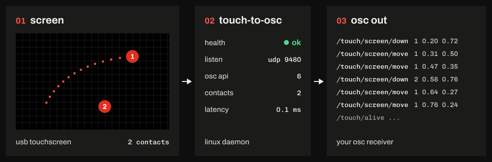

# touch-to-osc

Reads USB touchscreens on Linux and sends every touch out as OSC over UDP. It also reports
its own health over OSC: a heartbeat every second, a status you can subscribe to, events,
and an answer to every command.

It doesn't know what the touches are for. Positions go out as 0..1 of the screen and
whatever's receiving decides what they mean. The full OSC reference is in [OSC.md](OSC.md).

## Install

Grab the `.deb` from the GitHub releases. The one file works on Debian 11 to 13 and Ubuntu
22.04 and 24.04.

    gh release download -R Fohdeesha/touch-to-osc -p '*.deb'
    sudo apt install ./touch-to-osc_*_amd64.deb

That installs `touch-to-osc`, `touch-to-osc-watch` and the systemd service (enabled and
started), and writes `/etc/touch-to-osc/touch-to-osc.toml` if there isn't one yet.

Upgrading keeps your config and restarts the service, which ends any touches in progress,
so do it when nobody's using the screen. `apt remove` keeps the config, `apt purge` deletes it.

## Setup

1. Find your screen:

       sudo touch-to-osc --list

   It shows each touchscreen with its USB id, serial and port, and a `[[device]]` block
   to paste for any screen the config doesn't read yet.

2. In `/etc/touch-to-osc/touch-to-osc.toml`, set `match_usb` in the `[[device]]` block and
   add the IP of every machine that runs a receiver to `allowed_ips`.

3. Check it and restart:

       sudo touch-to-osc --check-config
       sudo systemctl restart touch-to-osc
       touch-to-osc --status

4. Run `touch-to-osc-watch --no-alive` and touch the corners. Top left should read about
   `0 0`, top right `1 0`, bottom left `0 1`, bottom right `1 1`. If not, see Lining up
   the touch panel.

## Config

Every key is in `config.example.toml` (also at `/usr/share/touch-to-osc/`) with its default
and what it does. The ones you'll actually use:

- `[osc]`: `listen` (UDP port for commands and subscriptions, 9480), `prefix` (`/touch`),
  `allowed_ips` (who may subscribe and send commands, 127.0.0.1 by default).
- `[[device]]`, one per screen: `id` (goes into the addresses, `/touch/<id>/down`),
  `match_usb`, `match_port`, `match_serial`, `rotation`, `mirror`, `calibration`, `aspect`,
  `silence_ms`, `usb_recovery`.
- `[[destination]]` (optional): receivers that get everything without subscribing.

A bad key, type or value is refused with a message naming it. If the config is broken when
the service starts, it keeps running on the last config that worked and its health says
why (on a fresh install with no good config yet, it just stays stopped).

**Settings changed over OSC win over the config file.** Anything changed over OSC (by a
receiver, or with `--send`) is saved in `/var/lib/touch-to-osc/settings.toml` and beats
the config. If you edit the config and nothing changes, that's why. `touch-to-osc --status`
lists what's overridden. To drop them:

    touch-to-osc --send settings/forget device/screen/rotation    one setting
    touch-to-osc --send settings/forget device/screen             all of one screen's
    touch-to-osc --send settings/forget                         everything

If you change a value in the config file after it was overridden, the config's new value
takes over again from the next start.

## Lining up the touch panel

Run `touch-to-osc-watch --no-alive` and sort out rotation and mirror first. They apply
live, so just try them:

    touch-to-osc --send device/screen/rotation 90     0, 90, 180 or 270, clockwise
    touch-to-osc --send device/screen/mirror x        x, y, xy, or "" for none

Touch the top right corner, it should read `1 0`. `0 0` means mirror `x`, `1 1` means
mirror `y`, `0 1` means rotation 180. If moving your finger right moves the reading up or
down, try rotation 90 or 270.

Then calibration, if it's offset or a bit too big or small. An app can do it for you with
guided calibration (see OSC.md). By hand: clear it with
`touch-to-osc --send device/screen/calibration` (no numbers), touch targets at 0.1 and 0.9 on
each axis, write down what x reads (`u1`, `u2`) and what y reads (`v1`, `v2`), then:

    a = 0.8 / (u2 - u1)    c = 0.1 - a * u1
    e = 0.8 / (v2 - v1)    f = 0.1 - e * v1

    touch-to-osc --send device/screen/calibration <a> 0 <c> 0 <e> <f>

Calibration lines the panel up with the display, not with a picture on it. Where a scaled
or letterboxed picture sits is the receiver's job. If the screen doesn't report its size,
set `aspect` too (1.778 for 16:9).

Anything set over OSC is saved. Copy the final values into the config if you want them
there as well.

## Several screens

One `[[device]]` block per screen, each with its own id. Two of the same model have the same
`match_usb`, so set `match_port` on each too (the USB socket, as `--list` shows it). Ports
follow the socket, not the screen, so label the cables.

To find out which screen is which, `touch-to-osc --send identify 30` pauses touches for
30 s and `touch-to-osc-watch` shows which screen each touch lands on.

## USB recovery

A flaky USB connection (a bad extender, a loose plug) can leave a screen plugged in that
the kernel has given up on until you replug it. With `usb_recovery = true` (the default),
when the screen's port sits like that for 10 s the daemon resets the USB hub so the kernel
tries again. It tries 5 times (10, 20, 40, 80 and 160 s apart), then stops and says so in
the health. Unplugging the screen starts it over. A port with nothing in it is never reset.

On a port of the computer itself a reset drops everything on that USB bus, so the daemon
only does it when nothing else is on it, and otherwise tells you what's in the way.
`sudo touch-to-osc --list` shows what else is on it. Give the screen a bus of its own, or
send `usb_reset` to reset it anyway.

## Troubleshooting

`touch-to-osc --status` shows the health and the reasons, which say what to do. The journal
(`journalctl -u touch-to-osc`) has the rest.

| Problem | Fix |
|---|---|
| No touches | `touch-to-osc --status`, then `sudo touch-to-osc --list` |
| `may not send commands here` | add the receiver's IP to `allowed_ips` |
| A config edit does nothing | a setting changed over OSC overrides it, see Config |
| A finger held still ends after 200 ms | the screen only reports while a finger moves: `silence_ms = 0` |
| Touches rotated, flipped or offset | see Lining up the touch panel |
| Two screens swapped | set `match_port` on each |
| `--dump` shows nothing | the service holds the screen, stop it first |
| Other USB devices drop out for a moment | someone sent `usb_reset`, see USB recovery |
| A tool gets no answer | answers go back to the port the command came from, so send and listen on the same one |

## Command line

    touch-to-osc --list [--all]               touchscreens and what the config makes of them
    touch-to-osc --list --touch               wait for a touch on a screen no device reads, and name it
    touch-to-osc --check-config[=FILE]        check the config and the saved settings
    touch-to-osc --status                     the running service's health and settings
    touch-to-osc --send ADDRESS [VALUE...]    send the service one command
    touch-to-osc --dump[=ID]                  raw touch frames (stop the service first)
    touch-to-osc-watch [--target IP:9480]     watch touches, status and events live

`--status`, `--send` and the watcher need their machine in `allowed_ips` (127.0.0.1 is in
it by default). `--help` lists the exit codes.

## OSC in short

Subscribe from your receiver's port and renew every few seconds (a lease lasts 10 s by
default):

    /touch/subscribe  i port [i seconds]

Then you get:

    /touch/screen/down    i contact  f x  f y  i frame  h t_us
    /touch/screen/move    i contact  f x  f y  i frame  h t_us
    /touch/screen/up      i contact  f x  f y  i frame  h t_us
    /touch/screen/cancel  i contact  s reason  i frame  h t_us
    /touch/alive ...    every second, with the contacts still down on each screen

plus the status, events and replies. Every contact ends with exactly one `up` or `cancel`,
and a `cancel` is never a tap. Drop everything you hold when the alives stop for 3 s or the
`run` changes. Settings are changed at the same address the status reports them on
(`/touch/device/screen/rotation 90`). Nothing creates a touch.

The rest (status fields, events, commands, the receiver rules, plain types for OSC
libraries without 64-bit ints) is in [OSC.md](OSC.md).

## Building

C++17, CMake 3.18 or newer, Ninja and libevdev:

    apt install build-essential cmake ninja-build pkg-config libevdev-dev
    scripts/build-deb.sh

That builds, runs the unit tests and puts the `.deb` in `build-deb/`. Build it on the oldest
system you want it to run on (releases are built on Debian 11). Without the package,
`sudo scripts/install.sh` installs under `/usr/local` and `scripts/uninstall.sh` takes it
out again.

## Tests

    build/tto_tests                            unit tests
    sudo python3 tests/e2e/run.py [--quick]    end-to-end, with virtual screens through /dev/uinput
    sudo python3 tests/hw/usb_recovery.py      USB recovery on a real screen

The end-to-end tests use UDP 19480-19499 and virtual screens with USB vendor 7470, so a
running service leaves them alone. The hardware test drops everything on the screen's USB
bus a few times. For sanitizers, configure with `-DTTO_SANITIZE=address,undefined` (or
`thread`) and run the tests with `TTO_BUILD=<that build dir>`.

## License

GPL-3.0, see LICENSE.
